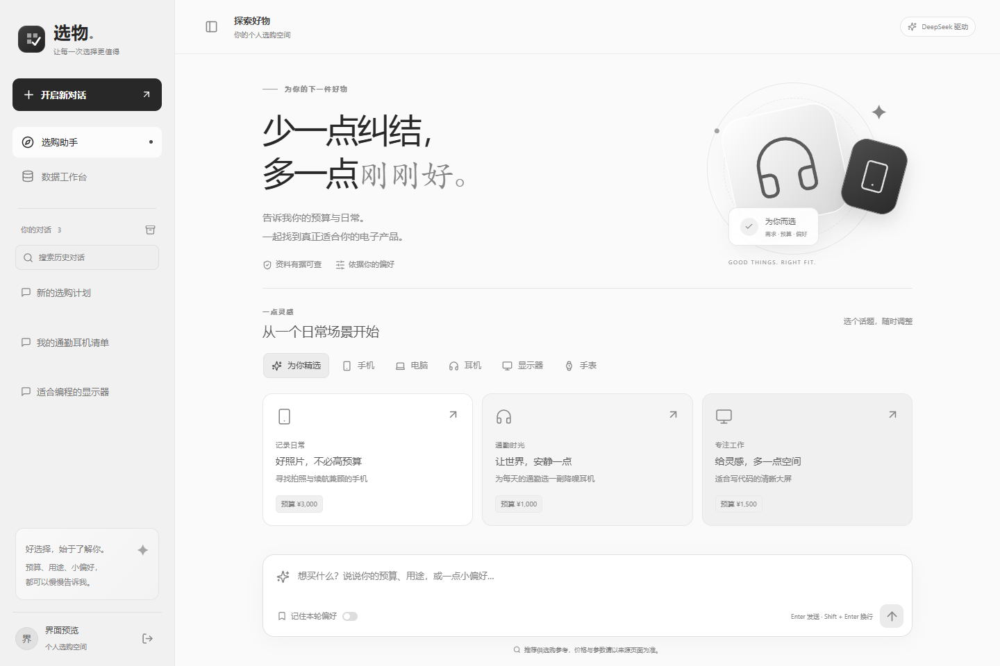
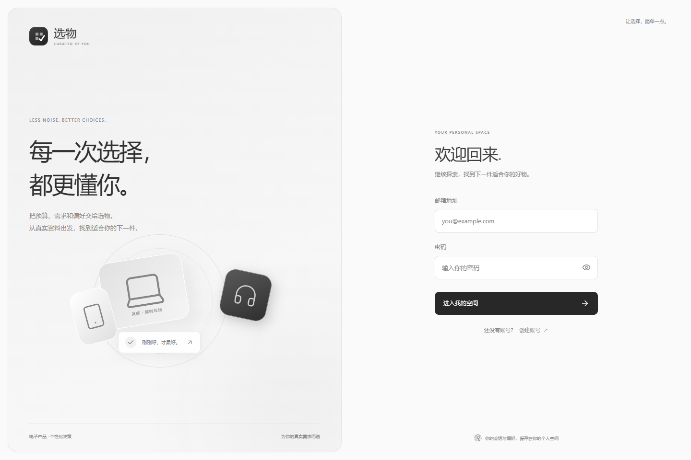
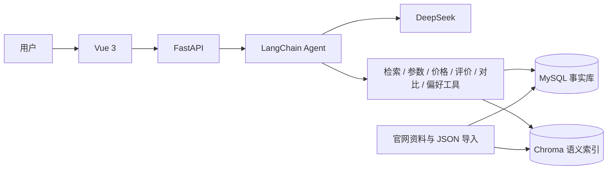

# Curio Agent · 选物

基于 **Vue 3 + FastAPI + LangChain + DeepSeek + MySQL + Chroma** 的电子产品消费决策助手。

用自然语言描述预算、用途和偏好，Agent 调用商品检索、参数、价格、评价与对比工具，生成可追溯的推荐。适合本地 Agent 开发、工具调用和多轮记忆实验。

## 界面预览

### 选购工作区



### 登录界面



> 截图中的账户与会话为界面测试数据。项目中的价格是带采集日期的快照，请重新核对官网，不代表实时价格。

## 功能

- 手机、笔记本、耳机、显示器、平板及智能手表的检索与对比。
- 预算、用途、硬性条件和偏好的提取，多轮会话与历史恢复。
- Agent 工具调用、流式回答、生成状态、停止生成和运行结果查询。
- MySQL 保存结构化事实，Chroma 保存可重建的语义检索索引。
- 商品卡片、对比表、引用来源及用户反馈。
- 用户注册登录，私有会话，授权后保存长期偏好。
- 管理员官网资料提取、JSON 草稿转换、核对导入与索引维护。
- 本地评测记录规则通过率、工具执行、延迟和 Token 等指标。

## 架构



商品事实以 MySQL 为准，Chroma 索引可以重建。模型负责理解需求、选择工具和组织回答；规格评分由确定性代码计算，缺失资料保留为缺失。

## 本地运行

环境：Python 3.11、Node.js 与 npm、MySQL 8.x，以及可用的 DeepSeek API Key。

### 1. 获取项目

```powershell
git clone https://github.com/826094932/curio-agent.git
cd curio-agent
conda create -n agent python=3.11 -y
conda activate agent
python -m pip install -e "./backend[dev]"
Copy-Item .env.example .env
```

编辑根目录 `.env`：

- `DEEPSEEK_API_KEY`：填写你自己的密钥。
- `MYSQL_DSN`：填写本地数据库用户名、密码及数据库名。
- `JWT_SECRET`：设置长随机字符串。
- `ADMIN_EMAILS`：需要数据管理界面时，填写管理员注册邮箱的 JSON 数组。
- `CRAWLER_DOMAINS`：按需配置允许采集的官网域名，默认为空。

可生成随机 JWT 密钥：

```powershell
python -c "import secrets; print(secrets.token_urlsafe(48))"
```

### 2. 初始化数据库并启动后端

先在 MySQL 中创建 `product_agent` 数据库，或者执行交互式配置脚本（会询问 MySQL 凭据，并写入本地 `.env`）：

```powershell
cd backend
python -m scripts.setup_local
python -m alembic upgrade head
python -m uvicorn app.main:app --host 127.0.0.1 --port 8000 --reload
```

### 3. 启动前端

另开一个终端，在项目根目录执行：

```powershell
cd frontend
npm ci
npm run dev
```

网页：<http://localhost:5173>。接口文档：<http://127.0.0.1:8000/docs>。

首次使用时注册账号。使用管理员邮箱注册后，可进入数据工作台。初始数据库为空，先导入核对过的商品资料；示例数据不能作为真实推荐依据。

### 4. 导入资料

`data/fixtures/` 提供格式示例，`data/import/` 提供附带来源和采集日期的官网快照。先核对资料，再按商品、价格、评价顺序导入。详细步骤见 [资料说明](data/import/README.md)。

首次检索或导入有效商品时，可能下载 Embedding 模型；可通过 `EMBEDDING_MODEL` 指定已有本地模型。

## 本地 Agent 评测

在已初始化数据库、索引和模型配置的条件下：

```powershell
cd backend
python evaluation/run.py --dry-run
python evaluation/run.py --version v1 --limit 1
python evaluation/run.py --version v1 --repeat 3
```

真实评测会调用 DeepSeek 并消耗 API 额度。运行输出保存在本地 `backend/evaluation/results/`，该目录不会提交到 Git。

规则通过率不等于最终回答正确率；质量仍需结合事实、预算、引用和人工评分判断。详见 [评测说明](backend/evaluation/README.md)。

## 项目结构

```text
curio-agent/
├── frontend/              # Vue 3、交互界面与流式聊天
├── backend/
│   ├── app/               # API、Agent、工具、鉴权和数据层
│   ├── alembic/           # 数据库迁移
│   ├── scripts/           # 配置、导入和索引维护
│   └── evaluation/        # 本地评测代码与案例
├── data/
│   ├── fixtures/          # 数据格式示例
│   └── import/            # 带来源日期的官网快照
├── .env.example           # 配置模板
├── main.py                # 根目录后端入口
├── agent.md               # 设计文档
└── IMPLEMENTATION.md      # 实现与运行说明
```

## 当前边界

价格来自公开快照；缺失规格不会自动补齐。官网提取以静态 HTML / JSON-LD 为主，提取结果需要核对。多轮历史和授权偏好已实现，更多持续学习与复杂多 Agent 能力可以基于当前工具和评测逐步扩展。


## 可选联网补充

输入框的「联网补充」默认关闭。开启后先检索本地商品，有合适候选时不联网；没有候选才复用网页缓存或调用 Tavily API。有效网页摘录按用户隔离存入 MySQL，并保留来源、获取时间和内容版本，供开启模式下后续推荐使用。关闭后保持原有本地检索与评分流程。

在本地 `.env` 配置 `TAVILY_API_KEY`，并在 backend 执行 `python -m alembic upgrade head`。具体缓存策略、数据边界和验证方法见 [联网补充说明](docs/web-search.md)。

## 最近更新

- 完善指定型号与别名匹配；对比时缺少任一型号即可联网补充，无关商品不再阻断搜索。
- 新增型号覆盖与联网触发回归测试，44 项测试通过。
